# openQCM NEXT

**Open-source Python software for the openQCM NEXT quartz crystal microbalance with dissipation monitoring.**

[](https://www.gnu.org/licenses/gpl-3.0)
[](https://www.python.org/)
[]()

This repository holds the host application that drives the openQCM NEXT instrument, the firmware
of its Teensy 4.0 controller and the reference documentation of the measurement chain. The
software sweeps the sensor's resonances, tracks the resonance frequency *f*<sub>n</sub> and the
dissipation of the fundamental and of the odd overtones *n* = 3, 5, 7, 9 in real time, controls the
sensor temperature and logs everything to CSV.

<p align="center">
  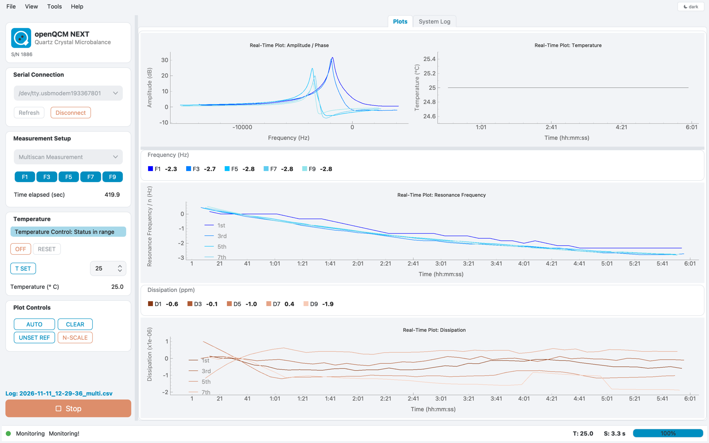
</p>
<p align="center"><sub>Multiscan run, five overtones of a 5 MHz sensor in air, TEC at 25.00 °C, <b>SET REF</b> and
<b>N-SCALE</b> on: frequency shifts Δf<sub>n</sub>/n and dissipation shifts over 7 min.</sub></p>

The README is written for two readers: whoever **uses** the instrument (§ 1–5) and whoever
**reads or modifies** the code (§ 6–9).

---

## Contents

1. [The QCM technique](#1-the-qcm-technique)
2. [The openQCM NEXT instrument](#2-the-openqcm-next-instrument)
3. [Installation](#3-installation)
4. [Operating the instrument](#4-operating-the-instrument)
5. [Output data](#5-output-data)
6. [Acquisition](#6-acquisition)
7. [Signal processing: from a sweep to *f* and *D*](#7-signal-processing-from-a-sweep-to-f-and-d)
8. [Software architecture](#8-software-architecture)
9. [Modifying the code](#9-modifying-the-code)
10. [Limits of the measurement](#10-limits-of-the-measurement)
11. [Repository layout](#11-repository-layout)
12. [License and links](#12-license-and-links)

---

## 1. The QCM technique

A quartz crystal microbalance is an AT-cut quartz disc between two electrodes. Driven by an AC
voltage it oscillates in **thickness-shear mode**; the fundamental resonance of a disc of thickness
*h*<sub>q</sub> is *f*<sub>0</sub> = *v*<sub>q</sub> / 2*h*<sub>q</sub> (5 MHz for 0.33 mm), and only the
**odd overtones** *n* = 3, 5, 7, … are piezoelectrically excited.

Anything coupled to the electrode surface changes the resonance:

- **Rigid thin film — Sauerbrey.** The frequency shift is proportional to the areal mass:

  $$\frac{\Delta f_n}{n} = -\frac{2 f_0^2}{\sqrt{\rho_q \mu_q}}\,\Delta m_A = -\frac{\Delta m_A}{C}, \qquad C = 17.7\ \mathrm{ng\,cm^{-2}\,Hz^{-1}}\ \text{at}\ f_0 = 5\ \mathrm{MHz}$$

  with ρ<sub>q</sub> = 2648 kg m⁻³ and μ<sub>q</sub> = 2.947·10¹⁰ Pa. A rigid film gives the same
  Δ*f*<sub>n</sub>/*n* on every overtone and no change of dissipation.

- **Newtonian liquid — Kanazawa–Gordon.** The shear wave decays in the liquid within
  δ = (η/πρ*f*<sub>n</sub>)<sup>1/2</sup> (≈ 250 nm in water at 5 MHz); frequency and bandwidth change together:

  $$\Delta f_n = -\sqrt{n}\, f_0^{3/2} \sqrt{\frac{\rho_l \eta_l}{\pi \rho_q \mu_q}}$$

- **Viscoelastic layers** (polymers, proteins, cells) shift frequency *and* broaden the resonance
  differently on each overtone; their modelling needs Δ*f*<sub>n</sub> and Δ*D*<sub>n</sub> on several *n*.

**Dissipation** is the energy lost per oscillation cycle, *D* = 1/*Q* = *W*<sub>n</sub>/*f*<sub>n</sub>, where
*W*<sub>n</sub> is the full width at half maximum of the resonance (conductance spectrum). A
QCM-D therefore measures, per overtone, a centre frequency and a width — which is exactly what a
**swept-frequency** instrument like openQCM NEXT reads from the shape of each resonance.
The definition of the width the software publishes is given in § 7.4.

## 2. The openQCM NEXT instrument

| | |
|---|---|
| Sensor | AT-cut quartz, 5 MHz or 10 MHz fundamental (auto-detected) |
| Overtones | 5 MHz: *n* = 1, 3, 5, 7, 9 · 10 MHz: *n* = 1, 3, 5 (sweep limited to 51 MHz) |
| Method | Passive frequency sweep (no oscillator loop); magnitude and phase of the sensor's transfer function |
| Synthesiser | AD9851 DDS, 125 MHz reference, 32-bit tuning word (0.029 Hz resolution) |
| Detector | AD8302 RF gain/phase detector: 30 mV/dB, 10 mV/° |
| Digitisation | Teensy 4.0 12-bit ADC, 500 readings averaged per frequency point |
| Tracking sweep | 18 001 points, 1 Hz step, *f*<sub>c</sub> − 12 kHz … *f*<sub>c</sub> + 6 kHz, ≈ 2 s per overtone |
| Survey sweep | 1–51 MHz, 500 Hz step, 100 001 points (Peak Detection) |
| Temperature | Thorlabs MTD415T TEC controller, PID, set point 5–45 °C |
| Host link | USB CDC serial, 115 200 baud, 8N1 |
| Outputs | *f*<sub>n</sub>, *D*<sub>n</sub>, temperature, TEC current; CSV datalog |

### Measurement principle

The sensor is the upper arm of a voltage divider. The AD8302 compares the voltage across the load
resistor with an attenuated copy of the drive voltage and returns their **ratio in dB** and the
**magnitude of their phase difference**:

<p align="center">
  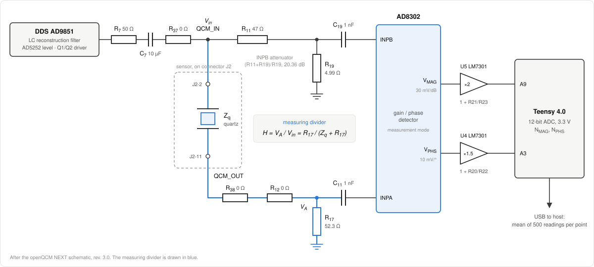
</p>

$$H(f) = \frac{V_A}{V_\text{in}} = \frac{R_L}{Z_q(f) + R_L}$$

At series resonance |*Z*<sub>q</sub>| is minimum (the motional resistance *R*<sub>m</sub>), so |*H*| has a
**maximum** and the phase difference passes through **zero**. The two ADC channels are converted to the
detector's units as

$$M = \frac{N_\text{MAG}\cdot\frac{3.3}{4096}/2 - 0.9}{0.030}\ [\mathrm{dB}], \qquad
P = \frac{N_\text{PHS}\cdot\frac{3.3}{4096}/1.5 - 0.9}{0.010}\ [\mathrm{deg}]$$

where 0.9 V is the AD8302 centre point. *P* reads 90° − |Δφ| plus a channel offset, so it too
peaks at resonance (Fig. 2b). The production chain uses **M only**; *P* is used to validate peaks
during Peak Detection.

## 3. Installation

**Requirements:** Python 3.9, an openQCM NEXT on a USB port.

The GUI uses the PyQt5 5.9 widget namespace, so the environment is pinned. The conda route is the
reproducible one (on Apple Silicon it runs the osx-64 build under Rosetta 2):

```bash
cd software
conda env create -f environment.yml      # python 3.9.12, pyqt 5.9.2, numpy 1.21.5, scipy 1.7.3, pyqtgraph 0.11.0
conda activate openqcm-next
python run.py                            # or: python -m openQCM
```

With pip: `pip install -r software/requirements.txt` (PyQt5 5.9.2 may not be available as a wheel on
recent systems).

**Linux:** add your user to the serial groups and log in again:
`sudo usermod -a -G dialout,uucp $USER`.

**Firmware.** The software checks the board's firmware against `Constants.FW_VERSION` (`0.1.5d`) at
connection and offers the update. The images and the Teensy loaders for macOS and Windows are in
[`software/openQCM/firmware_update/`](software/openQCM/firmware_update/); the sources are in
[`firmware/`](firmware/).

> The application must be started from `software/`: it reads and writes its runtime files
> (`openQCM/config.txt`, `PeakFrequencies*.txt`, `Calibration_*MHz.txt`) and the datalog folder
> `logged_data/` relative to that directory.

## 4. Operating the instrument

1. **Connect.** *Refresh* lists the serial ports; *Connect* opens the selected one and holds it
   (one instance per port). START and the temperature controls are enabled only when connected.
2. **Temperature.** Set **T SET** and switch the TEC **ON**; the live temperature is in the
   Temperature card and the status bar. PID parameters: *Tools → PID Control*. TEC current: *Tools → Tec Current*.
3. **Peak Detection.** Run it with the sensor mounted, and repeat it after changing the sensor. It finds the fundamental and the overtones, identifies the crystal
   (5/10 MHz) and stores the survey sweep used as baseline (§ 6.2).
4. **Measurement Setup.**
   - *Multiscan Measurement*: all detected overtones, one after the other, in a continuous cycle
     (≈ 8 s per 5-overtone cycle).
   - *Single Measurement*: one overtone, chosen with the F0…F9 selector (≈ 2 s per sweep).
   - *Sampling interval*: **Default** writes one datalog row per cycle; **10 / 30 / 60 s** write one
     row per interval with the mean of the cycles it contains.
5. **START.** The first 8 sweeps of each overtone fill the averaging buffer (§ 7.3); published
   values start after them. **STOP** ends the run and returns the port to the GUI immediately.

**Plots.** Resonance frequency and dissipation vs. elapsed time with per-overtone readouts;
amplitude, phase and temperature in a collapsible upper pane. **SET REF** plots shifts relative to
the current values; **N-SCALE** divides each plotted frequency by its order *n* (display only: the
datalog keeps the measured values), so that a Sauerbrey film collapses the overtones onto one curve.
Right-click menu per plot (auto-scale, pan, grid), **Δ cursors**
(Δt, Δ*F*, Δ*D*), light and dark theme (*View → Theme*).

**Views** (*Tools*): *Raw Data View* — the current sweep with filter, spline fit, peak and band as
measured; *Peak Data View* — the Peak Detection survey; *Raw Data (from sweep files)*; *File → Open
Log…* — any recorded CSV, with two-window statistics; *Check Firmware Version*, *Check Board Serial
Number*.

<p align="center">
  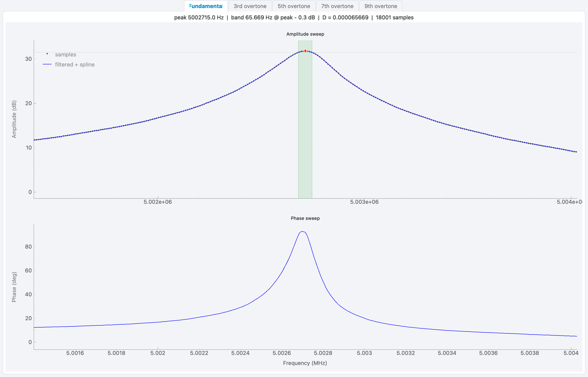
  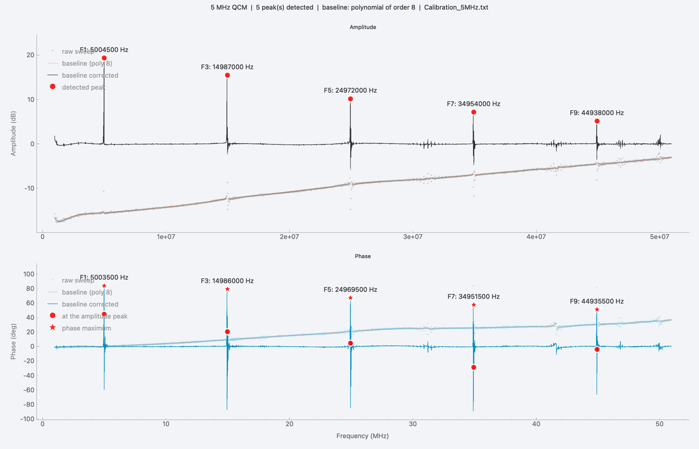
</p>
<p align="center"><sub>Raw Data View (left, fundamental of the run above) and Peak Data View (right, Peak Detection on the same sensor).</sub></p>

## 5. Output data

Datalogs are written to `software/logged_data/`, one file per run, named by start time.

**Multiscan** — `YYYY-MM-DD_hh-mm-ss_multi.csv`

| Column | Unit | Content |
|---|---|---|
| `Date`, `Time` | local | instant of the cycle's last sweep |
| `Relative_time` | s | time since START |
| `Temperature` | °C | sensor temperature, robust mean |
| `Frequency_k` | Hz | resonance frequency of the *k*-th detected peak (*k* = 0 → *n* = 1, 1 → 3, …) |
| `Dissipation_k` | — | −0.3 dB bandwidth / 10⁶ Hz (§ 7.4) |

**Single** — `YYYY-MM-DD_hh-mm-ss_F<n>.csv` (`F0` = fundamental, `F3` … `F9`): `Date, Time, Relative_time, Temperature,
Resonance_Frequency, Dissipation`, same units.

> A multiscan row omits the pair of an overtone whose value is zero (an overtone not detected
> by Peak Detection), so a file can hold fewer than 14 fields per row. *Open Log…* handles both forms.

**Raw sweeps.** `OPENQCM_SWEEP_DUMP=1 python run.py` writes the latest sweep of each overtone to
`openQCM/sweep_data/<n>.txt` (frequency, *M*, *P*; overwritten at every sweep, copy the files to keep
them) — the input used for the figures below. Format: [`software/docs/DATA_FORMAT_sweep_data.md`](software/docs/DATA_FORMAT_sweep_data.md).

## 6. Acquisition

### 6.1 Serial protocol

The board sweeps once per command. One overtone of a multiscan cycle:

<p align="center">
  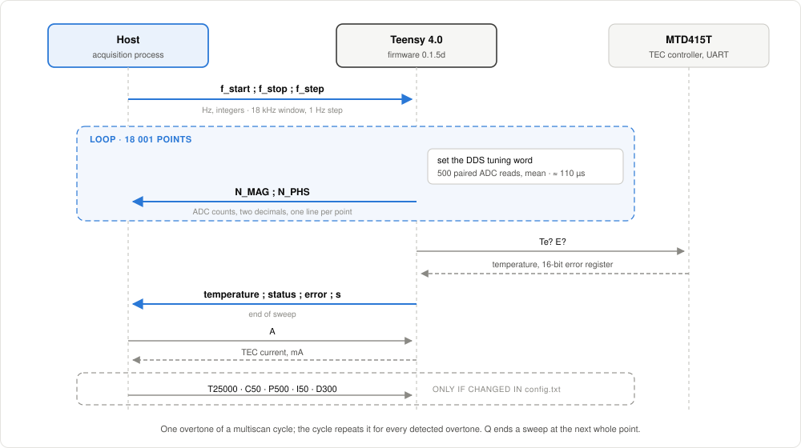
</p>

| Command | Response / effect |
|---|---|
| `start;stop;step` | Sweep, Hz, integers. One `N_MAG;N_PHS` line per point (ADC counts, mean of 500 readings, two decimals), then `temperature;status;error_register;s` |
| `Q` | Stop the sweep in progress at the next whole point; the closing line is still sent |
| `F` | Firmware version |
| `S` | Board identification number (`SSNN`, from EEPROM) or `NO_SERIAL` |
| `A` | TEC current, mA |
| `E` | MTD415T 16-bit error register |
| `Tx` · `Lx` | Temperature set point (m°C, 5000–45000) · TEC current limit (mA) |
| `Cx` `Px` `Ix` `Dx` | PID cycling time (ms) and P, I, D shares |
| `X1` · `X0` | TEC control on · off |

### 6.2 Peak Detection

The survey covers 1–51 MHz in 10 sections of 5 MHz at 500 Hz (100 001 points). An 8th-order
polynomial fitted to the whole span is the **baseline**: the circuit's frequency response without
the narrow resonances. Peaks are searched on the baseline-corrected magnitude:

- **fundamental:** the largest local maximum (`scipy.signal.argrelextrema`, ±3 MHz order) between
  1 and 12 MHz; its position classifies the crystal as 5 or 10 MHz;
- **overtones:** the largest local maximum within ±250 kHz of *n*·*f*<sub>1</sub>, *n* = 3, 5, 7, 9, up to 51 MHz;
- **validation:** an overtone is discarded if its magnitude and phase maxima are more than 12.5 kHz
  apart, or if the phase maximum is ≤ 10°.

The peak frequencies go to `PeakFrequencies.txt`, the survey to `Calibration_5MHz.txt` /
`Calibration_10MHz.txt`. The baseline polynomial is refitted from that file at every START and
subtracted from every tracking sweep.

<p align="center">
  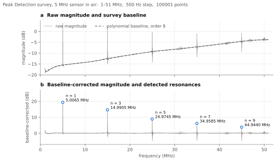
</p>

*Fig. 1 — Survey sweep, 5 MHz sensor in air. (a) Raw magnitude and 8th-order baseline. (b) Baseline-corrected
magnitude and the five detected resonances. At 500 Hz the resonances (≈ 130 Hz wide in air) are only
one or two samples wide: the survey locates them, it does not measure them.*

### 6.3 Tracking sweep

Each overtone is then swept at 1 Hz over an 18 kHz window, asymmetric around the centre
*f*<sub>c</sub> (12 kHz below, 6 kHz above). For the first 8 sweeps *f*<sub>c</sub> is the Peak
Detection frequency; afterwards it is the integer part of the published (averaged) frequency, stored
in `PeakFrequenciesRT.txt` at every sweep: **the window follows the resonance.**

<p align="center">
  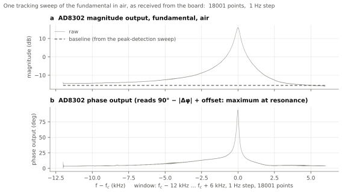
</p>

*Fig. 2 — One raw tracking sweep of the fundamental in air, as received from the board: (a) magnitude
M and the survey baseline evaluated on the window; (b) phase output P.*

## 7. Signal processing: from a sweep to *f* and *D*

All the processing lives in [`software/openQCM/core/resonance.py`](software/openQCM/core/resonance.py)
(chain) and [`core/averaging.py`](software/openQCM/core/averaging.py) (averaging). Both acquisition
modes and every viewer call these functions, so what is drawn is what was measured.

$$N_\text{MAG} \rightarrow M(f) \xrightarrow{-\,p_8(f)} M_c(f) \xrightarrow{\text{SG }51/3} \xrightarrow{\text{spline},\ 1\,\text{Hz}} \left(f_r,\ \Delta f_{0.3\,\text{dB}}\right)_\text{sweep} \xrightarrow{\text{trimmed mean, 8 sweeps}} \left(f_n,\ D_n\right)$$

### 7.1 Filtering and fit

1. **Baseline correction** — *M*<sub>c</sub>(*f*) = *M*(*f*) − *p*<sub>8</sub>(*f*), with *p*<sub>8</sub> the
   survey polynomial.
2. **Savitzky–Golay** — local cubic least-squares over 51 points (51 Hz); removes the point-to-point
   noise, 0.013 dB rms in air (Fig. 3a, residual), while preserving the peak shape.
3. **Smoothing spline** — `scipy.interpolate.UnivariateSpline`, smoothing factor *s* = 1, evaluated on
   a 1 Hz grid spanning the window.

### 7.2 Resonance frequency and band

On the fitted curve:

- *f*<sub>r</sub> is the frequency of the **maximum**;
- the band edges are the two frequencies where the curve falls **0.3 dB below the maximum**, found by
  walking outwards from the peak and interpolating linearly between the samples that straddle the
  threshold;
- the band is Δ*f*<sub>0.3 dB</sub> = *f*<sub>trailing</sub> − *f*<sub>leading</sub>.

The threshold is a fixed **drop in dB below the maximum**, not a fraction of it: the corrected curve
crosses zero, so a proportional threshold would follow the baseline instead of the peak. If an edge
is not crossed inside the window, the band is flagged as truncated (`err_left` / `err_right`).

<p align="center">
  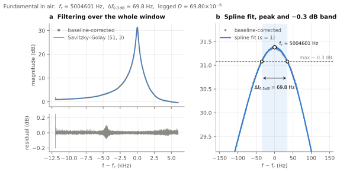
</p>

*Fig. 3 — The chain applied to the sweep of Fig. 2. (a) Baseline-corrected data and Savitzky–Golay output;
below, their difference. (b) Spline fit around the peak: f<sub>r</sub>, the −0.3 dB threshold, the
interpolated edges and the band Δf<sub>0.3 dB</sub> = 69.8 Hz.*

### 7.3 Robust averaging

Each sweep yields one (*f*<sub>r</sub>, Δ*f*<sub>0.3 dB</sub>) pair per overtone. They enter a ring
buffer of the last **8 sweeps** of that overtone (`Constants.environment`), and the published value
is a **trimmed mean**: the buffer is sorted, *k* = max(1, ⌊0.10·*N*⌋) samples are dropped from each
tail, the rest is averaged. With *N* = 8 that is the mean of the 6 central values, so one outlying
sweep never reaches the datalog. Temperature is averaged the same way. Since *f*<sub>r</sub> lies on
a 1 Hz grid, the published frequency moves in steps of 1/6 Hz.

### 7.4 Published quantities

$$f_n = \overline{f_r}^{\,\text{trim}}, \qquad D_n = \frac{\overline{\Delta f_{0.3\,\mathrm{dB}}}^{\,\text{trim}}}{10^6\ \mathrm{Hz}}$$

The GUI shows *D*<sub>n</sub> × 10⁶, i.e. the band in Hz, labelled "ppm".

> *D*<sub>n</sub> is a **width index**, not the dimensionless *W*<sub>n</sub>/*f*<sub>n</sub> of § 1: it is not
> normalised by *f*<sub>n</sub>, and the −0.3 dB width is measured on the dB magnitude of |*H*|, not as the
> FWHM of the conductance. For one overtone it increases monotonically with the damping of the
> resonance and is the quantity to track over time; to compare overtones or instruments, use it as a
> relative shift Δ*D*<sub>n</sub>.

### 7.5 Response to liquid loading

The same chain applied to sweeps of one sensor in air, water and isopropanol (three snapshots per
medium, TEC at 25 °C):

<p align="center">
  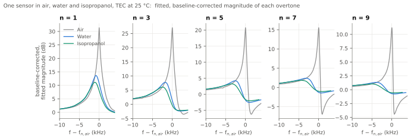
</p>

*Fig. 4 — Fitted, baseline-corrected resonances of the five overtones in air, water and isopropanol,
on a common axis f − f<sub>n,air</sub>. In liquid the resonance shifts down and flattens; at n = 9 its
height falls to ≈ 1 dB.*

<p align="center">
  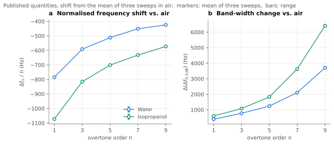
</p>

*Fig. 5 — Shifts relative to air, published quantities: (a) Δf<sub>n</sub>/n; (b) change of
Δf<sub>0.3 dB</sub>. Markers: mean of three sweeps; bars: their range (smaller than the markers).*

| Medium | *f*<sub>1</sub> (Hz) | Δ*f*<sub>0.3 dB,1</sub> (Hz) | *f*<sub>3</sub> (Hz) | Δ*f*<sub>0.3 dB,3</sub> (Hz) | *f*<sub>5</sub> (Hz) | Δ*f*<sub>0.3 dB,5</sub> (Hz) |
|---|---|---|---|---|---|---|
| Air | 5 004 599 | 70.0 | 14 988 750 | 71.9 | 24 973 699 | 87.7 |
| Water | 5 003 814 | 468.2 | 14 986 977 | 849.0 | 24 971 138 | 1 330.5 |
| Isopropanol | 5 003 527 | 674.2 | 14 986 304 | 1 153.8 | 24 970 193 | 1 918.1 |

The figures are produced by [`docs/figures/make_readme_figures.py`](docs/figures/make_readme_figures.py)
from raw sweep dumps, using the production functions and constants (dataset of 2026-09-11, firmware 0.1.5c).

## 8. Software architecture

### 8.1 Process model

Acquisition and processing run in a **separate process**, so that a 2 s serial sweep never blocks
the interface and a GUI stall never loses a sweep.

<p align="center">
  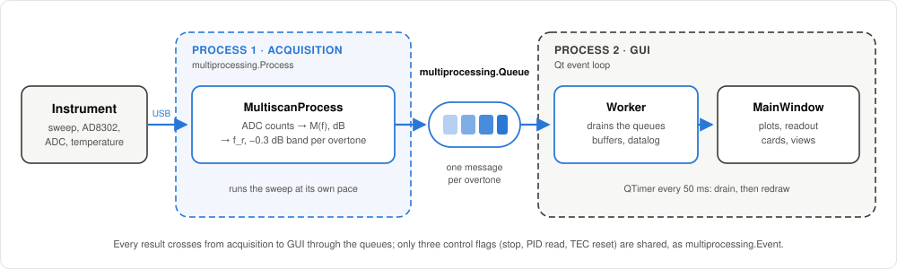
</p>

In detail:

<p align="center">
  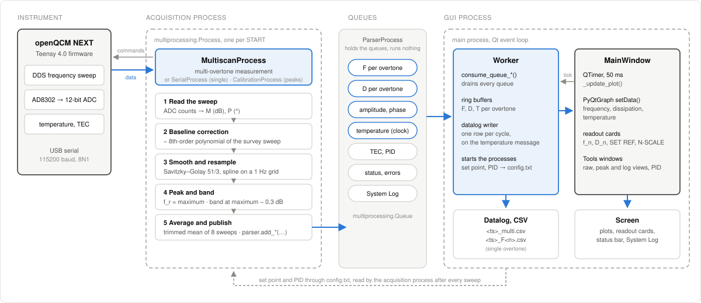
</p>

- **Acquisition process** — one of three `multiprocessing.Process` subclasses in `processors/`,
  chosen by the operating mode. It owns the serial port for the duration of the run, sends the sweep
  commands, converts and processes each sweep (§ 7) and posts the results to queues.
- **Queues** — `ParserProcess` (`processors/Parser.py`) is the container of the queues handed to the
  child; it is not started as a process. One queue per data stream: amplitude, phase, frequency and
  dissipation per overtone, temperature (which also carries the end-of-cycle flag that triggers a
  datalog row), TEC current, status/errors, messages, PID read-back.
- **Worker** (`core/worker.py`) — lives in the GUI process. On every timer tick it drains the queues
  into ring buffers (8192 samples per series) and writes the datalog row when a cycle closes.
  Timestamps are taken in the acquisition process, so a late drain never shifts a row in time.
- **MainWindow** — builds the single-window interface programmatically (sidebar cards, Plots and System
  Log tabs) and redraws a plot only when new data arrived or its view changed.
- **GUI → acquisition** — temperature set point and PID values travel through `openQCM/config.txt`,
  re-read by the acquisition process after every sweep; PID read-back and TEC reset are flag requests
  on the parser object. STOP terminates the child and sends `Q`, so the board abandons the sweep in
progress and the port is free at once.

The child is started with the `spawn` method on macOS and Windows: modules it imports must not pull in
Qt or the GUI at import time (`run.py` imports the application only under `__main__` for this reason).

### 8.2 Modules

| Package | Module | Role |
|---|---|---|
| `core/` | `resonance.py` | Savitzky–Golay, spline fit, peak and −0.3 dB band: **the only implementation** |
| | `averaging.py` | Trimmed mean with a one-sample floor per tail |
| | `worker.py` | Process lifecycle, queue draining, ring buffers, datalog |
| | `constants.py` | Every tunable parameter (§ 9) |
| | `ringBuffer.py` · `logAnalysis.py` | Circular buffer · two-window statistics of a logged run |
| `processors/` | `Multiscan.py` · `Serial.py` | Multi-overtone and single-overtone acquisition |
| | `Calibration.py` | Peak Detection |
| | `Parser.py` | Queue container |
| `common/` | `fileStorage.py` · `sweepDump.py` | CSV datalog · raw sweep dump (`OPENQCM_SWEEP_DUMP=1`) |
| | `tecStatus.py` · `tecReset.py` · `pidQuery.py` | MTD415T error register, reset, PID read-back |
| | `runtimeFiles.py` · `fileManager.py` · `logger.py` · `architecture.py` · `fdLimit.py` | Support |
| `ui/` | `mainWindow.py` · `mainWindow_ui.py` | Controller and layout of the main window |
| | `rawDataView.py` · `peakDataView.py` · `dataLogView.py` | Sweep, survey and log viewers |
| | `pidControlDialog.py` · `tecCurrentView.py` | TEC windows |
| | `theme.py` · `widgets.py` · `plotMenu.py` · `popUp.py` | Theme, shared widgets, plot menu, dialogs |

## 9. Modifying the code

**Parameters.** The measurement is defined by `core/constants.py`; change it there, never with a
literal at the call site:

| Constant | Value | Meaning |
|---|---|---|
| `LEFT`, `RIGHT` | 12000, 6000 Hz | Tracking window around *f*<sub>c</sub> |
| `FREQUENCY_STEP` | 1 Hz | Tracking step |
| `BASELINE_POLY_ORDER` | 8 | Order of the survey baseline |
| `SG_WINDOW_SIZE`, `SG_order` | 51, 3 | Savitzky–Golay filter |
| `SPLINE_FACTOR` | 1 | Spline smoothing factor |
| `THRESHOLD_DB` | 0.3 dB | Band threshold below the maximum |
| `environment` | 8 | Sweeps in the averaging buffer (and warm-up length) |
| `trim_mean_proportiontocut` | 0.10 | Fraction trimmed per tail |
| `calibration_frequency_start/stop`, `calib_fStep` | 1–51 MHz, 500 Hz | Survey sweep |
| `plot_update_ms` | 50 ms | GUI timer |
| `FW_VERSION` | `0.1.5d` | Firmware the software expects |

**Rules that keep the measurement consistent.**

- Anything that computes or draws a frequency or a band calls `core/resonance.py`. Averaging goes
  through `core/averaging.robust_mean`. Plot menus, cards and sweep dumps have their shared modules
  (`ui/plotMenu.py`, `ui/widgets.py`, `common/sweepDump.py`); extend them rather than copying.
- A new estimator is added **beside** the published one, selectable before START, with its own
  datalog columns; run parameters reach the child through the `Worker`, not by mutating `Constants`.
- To test a change of the chain without hardware, record raw sweeps with `OPENQCM_SWEEP_DUMP=1` and
  replay them offline through `resonance.analyze_sweep` (as `docs/figures/make_readme_figures.py` does).

**Runtime files** under `software/openQCM/`, rewritten by the application:

| File | Content |
|---|---|
| `config.txt` | T set point (m°C), PID cycling time, P, I, D, two control flags |
| `PeakFrequencies.txt` | Peaks from the last Peak Detection |
| `PeakFrequenciesRT.txt` | Current tracking centres |
| `Calibration_5MHz.txt`, `Calibration_10MHz.txt` | Last survey sweep (baseline source) |

`config.txt` is tracked (the application cannot start without it) but its content is per machine;
put it aside before pulling: `git stash push software/openQCM/config.txt`, `git pull`, `git stash pop`.

**Firmware** — Teensy 4.0 sketches in [`firmware/`](firmware/), current `0.1.5d`. The `-TEST` variants
run without the TEC controller; `openQCM_Next_SerialNumber/` writes the board identification number to
EEPROM once per board. Datasheets of the main components are in [`docs/datasheet/`](docs/datasheet/).

**Branches.** `main` is the production line. `impedance-analysis` is experimental: it publishes
frequency and dissipation from the conductance spectrum *G*(*f*) obtained by inverting the divider of
§ 2 with magnitude and phase.

## 10. Limits of the measurement

- **Absolute frequency** follows the 125 MHz DDS reference, which is not calibrated: an error of
  *x* ppm moves every frequency by *x* ppm (25 ppm = 125 Hz at 5 MHz). **Frequency differences** within a
  run are not affected.
- **Width.** *D*<sub>n</sub> is the −0.3 dB width of |*H*| in dB (§ 7.4). In heavily damped conditions the
  resonance height drops to ~1 dB (Fig. 4, *n* = 9 in liquid) and the band covers a large fraction of
  the peak.
- **Time resolution.** One value per overtone every cycle (≈ 8 s for five overtones, ≈ 2 s in single
  mode), averaged over 8 sweeps: the published series has an effective window of ~1 min in multiscan.
- **Overtone range.** The sweep stops at 51 MHz: a 10 MHz sensor provides *n* = 1, 3, 5.
- **Sweep start.** The firmware does not wait for settling after a frequency step; the first ~10
  points of each sweep are a transient (visible at the left edge of Fig. 3a). They lie 12 kHz from the
  resonance and are smoothed together with the rest.

## 11. Repository layout

```text
openqcm-next/
├── software/
│   ├── run.py                      entry point
│   ├── environment.yml             conda environment (pinned)
│   ├── requirements.txt            pip equivalent
│   ├── openQCM/
│   │   ├── app.py · __main__.py    application bootstrap
│   │   ├── core/                   processing, averaging, worker, constants
│   │   ├── processors/             acquisition processes
│   │   ├── common/                 storage, TEC, support
│   │   ├── ui/                     main window, views, theme
│   │   ├── firmware_update/        Teensy loaders and firmware images
│   │   └── *.txt                   runtime files (§ 9)
│   └── docs/                       sweep file format, license
├── firmware/                       Teensy 4.0 sketches
├── docs/
│   ├── figures/                    README figures and their generator
│   └── datasheet/                  AD8302, AD9851, AD5251/52, MTD415T, Teensy 4.0
├── research/peak-detection/        peak-detection prototypes
├── CHANGELOG.md                    change history
└── HANDOFF.md                      developer notes
```

## 12. License and links

GNU General Public License v3.0 — see [`software/docs/LICENSE.txt`](software/docs/LICENSE.txt).

Developed by the [openQCM](https://openqcm.com/) team at Novaetech S.r.l.

- Website: [openqcm.com](https://openqcm.com/)
- Repository: [github.com/openQCM/openqcm-next](https://github.com/openQCM/openqcm-next)
- Contact: [info@openqcm.com](mailto:info@openqcm.com)
